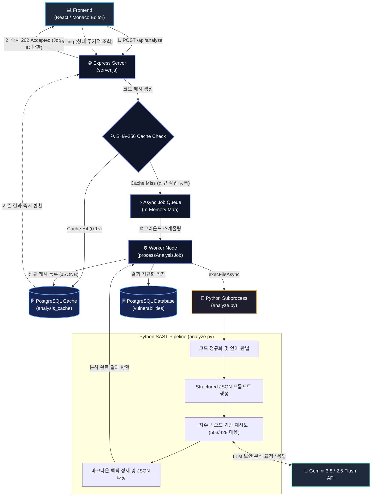

# 🛡️ AI 기반 소스코드 보안 취약점 자동 분석 및 패치 IDE 플랫폼

> **대규모 언어 모델(LLM)을 활용하여 개발 중인 코드의 취약점을 실시간으로 분석하고 패치 방안을 제시하는 웹 기반 보안 IDE**

---

## 📌 프로젝트 소개 (Overview)
기존 정적 보안 분석 도구는 복잡한 설치 과정과 높은 학습 비용, 결과 해석의 어려움이 존재합니다.  
본 프로젝트는 **GPT 기반 LLM 모델과 비동기 파이프라인**을 결합하여, 개발자가 웹 환경에서 작성 중인 코드의 취약점을 실시간으로 탐지하고 직관적인 설명 및 수정(패치) 코드를 즉시 제공받을 수 있도록 지원합니다.

- **팀명:** Team pp
- **구분:** 캡스톤 디자인 프로젝트

---

## ✨ 주요 기능 (Key Features)

- **웹 기반 통합 개발 환경 (Web IDE)**
  - 브라우저 환경에서 소스코드를 직접 작성 및 수정하고 프로젝트 단위로 관리
- **실시간 비동기 취약점 탐지**
  - 메시지 큐(Message Queue)를 활용한 비동기 분석 워커 처리 및 부하 분산
- **3단계 LLM 프롬프트 분석 파이프라인**
  1. **요약:** 업로드된 코드의 주요 취약점 목록 도출
  2. **수정 코드 제시:** 취약점을 보완한 패치 코드 자동 생성
  3. **상세 설명 및 메타데이터:** 작동 원리, 적용 전후 차이점, 취약 라인 번호 분석
- **분석 보고서 및 대시보드**
  - 파일별 취약점 해설, 패치 코드 비교 뷰, 수정 방안 원클릭 복사
  - 프로젝트별 누적 취약점 트렌드 및 통계 시각화

---

## 🏗️ 시스템 아키텍처 (System Architecture)

### 파이프라인 최적화
- **Code Pre-processing:** AST 분석을 통한 함수 단위 청크 분할 및 주석·공백 정규화
- **Batching & Caching:** 유사 요청 배치 처리 및 동일 코드 패턴에 대한 캐시 응답 재사용으로 토큰 비용 절감
- **Output Validation:** 제안된 패치 코드의 컴파일 가능 여부 및 형식 무결성 자동 검증

---

## 💻 화면 구성 (Screenshots)

| 메인 대시보드 & 프로젝트 관리 | 웹 에디터 & 분석 요청 |
| :---: | :---: |
| 프로젝트 목록 생성 및 단위 관리 | Monaco Editor 기반 소스코드 작성 및 실행 |

| 분석 결과 출력 | 취약점 상세 리포트 |
| :---: | :---: |
| 취약점 유형, 해설, 패치 코드 비교 | SQL Injection, RCE 등 유형별 세부 보고서 |

---

## 🛠️ 기술 스택 (Tech Stack)

### Frontend
- Web Editor (Monaco Editor 기반), Responsive Dashboard UI

### Backend & Architecture
- REST API Server, Microservice
- Message Queue (Kafka / RabbitMQ)
- Database: PostgreSQL

### AI & Analysis
- OpenAI GPT API (Few-shot Prompt Engineering)
- Static Code Analysis Pipeline (AST Parsing / Tokenization)

---

## 👥 팀원 및 역할 (Team & Roles)

| 이름 | 역할 | 담당 업무 |
| :--- | :---: | :--- |
| **허창민** | 백엔드 · AI 파이프라인 | • 서버 아키텍처, ERD 및 DB 스키마 설계 • 정적/동적 분석 도구 연동 및 결과 파싱·저장 • LLM 호출 파이프라인 및 취약점 피드백 로직 구현 |
| **이욱재** | 프론트엔드 · UI · API | • 화면 흐름 설계 및 UI/와이어프레임 구축 • 파일 업로드 컴포넌트, 분석 결과 리포트 및 대시보드 UI 구현 • 데이터 제공 API 최적화 및 부하 테스트 |
---
